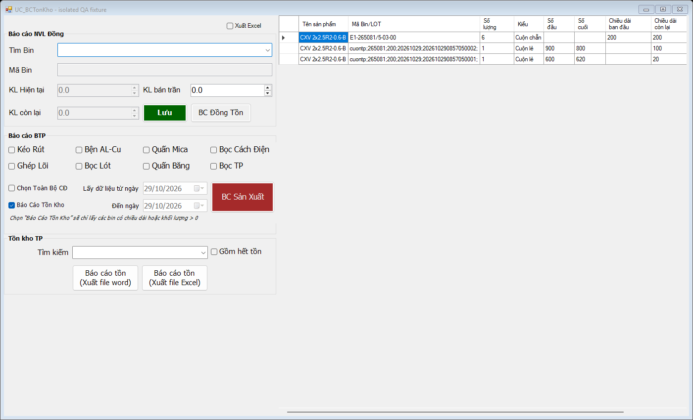
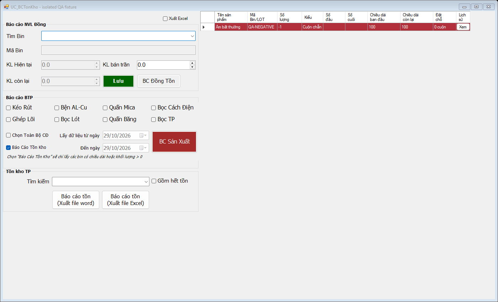

# Báo cáo kiểm thử và nghiệm thu UC_BCTonKho

## A. Tổng quan

Thời gian kiểm thử: **29–30/10/2026**, múi giờ Asia/Saigon; hoàn tất báo cáo ngày 30/10/2026. Kết luận: **KHÔNG ĐẠT**. Có ca tồn vật lý tăng sai và dữ liệu bất thường bị che khuất; chưa đưa chức năng vào sử dụng tại nhà máy.

Mã kiểm thử: HEAD `fbb43d46ef9cbb97948570161a02701e9e705b64` **kèm thay đổi chưa commit có sẵn**: `.csproj`, `UC_BCTonKho.cs`, Designer và hai file Model/DB mới. Đây là kiểm thử working tree hiện tại, không phải chỉ HEAD. Hash đầu/cuối của năm đầu vào không đổi: [trước](uc-bctonkho-evidence/application-source-before.json), [sau](uc-bctonkho-evidence/application-source-after.json).

Môi trường: Windows, .NET Framework 4.8, MSBuild Visual Studio `18.10.1.42706`, System.Data.SQLite 1.0.119. Harness C# chạy STA, target x64, nạp assembly ứng dụng vừa build; dùng control WinForms và message loop thật. Không khởi chạy luồng startup/MainForm có thể truy cập database gốc. Runtime config của harness sao chép binding redirects từ ứng dụng. Có một cảnh báo CS8012 của harness do khác processor target; không có lỗi build ứng dụng. [Thông tin môi trường](uc-bctonkho-evidence/environment.json).

Dữ liệu:

- `database/QLSX_v02.db` trong repo: 512.000 byte, chỉ có 1/12 bảng cần kiểm thử; không dùng file này để suy ra lỗi nghiệp vụ.
- Database đang cấu hình `D:\Database\QLSX_v02.db`: 36.651.008 byte. Đã sao chép vào `uc-bctonkho-evidence/configured-snapshot.db`, xác minh hash nguồn/bản sao bằng nhau, schema đủ 12 bảng rồi mới thực hiện đối chiếu nghiệp vụ trên bản sao với `Read Only=True;FailIfMissing=True`.
- 84 fixture theo ca được tạo mới tại `uc-bctonkho-evidence/cases/<ID>.db`. Schema từ `tests/fixtures/execution-edit/base-schema.sql`, bổ sung cột tìm tên đã xác minh trong schema thực. Seed riêng: [SQL](../../tests/UC_BCTonKho.Acceptance.seed.sql). Ca thiếu mốc dùng schema lỗi riêng cho phép NULL; ca mồ côi cố ý phá liên kết trên fixture, không phải trên dữ liệu thật.
- Hai DB gốc giữ nguyên SHA-256 trước/sau; không commit, push, merge hay sửa mã nghiệp vụ. Các script hồi quy ExecutionEdit dựng schema bằng SQL trong database tạm mới, không áp dụng migration lên database có sẵn hoặc bản sao dữ liệu thật.

**Tổng: 112 đơn vị kiểm thử — 101 PASS / 7 FAIL / 4 BLOCKED / 0 NOT RUN. Điểm: 84/100. Critical: 0; High: 2.**

Quy tắc đếm: mỗi ca mới là một đơn vị; mỗi script hồi quy là một đơn vị; thêm build, kiểm tra kiến trúc và một lượt GUI trực tiếp. Không cộng lặp các assertion bên trong script. 84 ca mới có 78 PASS/6 FAIL; 11 ca dữ liệu thực PASS; 14 script hồi quy được đánh giá 10 PASS/1 FAIL/3 BLOCKED; build và kiến trúc PASS; GUI trực tiếp BLOCKED. Ba script BLOCKED đã chạy và trả exit 1, nhưng tiền điều kiện/hợp đồng test không phù hợp nên không quy kết thành lỗi sản phẩm.

Không tái sử dụng kết quả PASS từ báo cáo triển khai cũ. Các số trên lấy từ lượt chạy mới và log kèm theo.

| Nhóm điểm | Tối đa | Đã chứng minh đạt | Không đạt | Chưa xác minh | Cơ sở |
|---|---:|---:|---:|---:|---|
| Build và tích hợp kiến trúc | 10 | 10 | 0 | 0 | BUILD, ARCH, 01-02 |
| Dropdown, tìm kiếm, lựa chọn | 15 | 14 | 0 | 1 | 02, 03; chuột/bàn phím desktop còn bị chặn |
| Tồn cuộn chẵn | 15 | 11 | 4 | 0 | 04, REAL-02; INV-001 |
| Tồn lẻ và cắt | 15 | 12 | 3 | 0 | 05, 06, REAL-03/04/08; INV-001/003 |
| Đặt chỗ và FIFO | 15 | 15 | 0 | 0 | 07, 08, 10-10 |
| Checkbox và bất thường | 10 | 6 | 4 | 0 | 09, 10; INV-002, UI-001 |
| Grid 10 cột | 10 | 9 | 1 | 0 | 11, ảnh render; UI-002 |
| Waiting, async, hồi quy, an toàn | 10 | 7 | 1 | 2 | 12, 13, 14; REG-001 và ba script cũ bị chặn |
| **Tổng** | **100** | **84** | **13** | **3** | Không cho điểm phần chưa xác minh |

Điểm là mức bao phủ tiêu chí có trọng số, không phải tỷ lệ số ca PASS. Dù đạt điểm cao hơn, INV-001 vẫn là điều kiện loại trực tiếp theo prompt.

## B. Chi tiết kiểm thử

### Lệnh tái hiện

Chạy tại thư mục gốc workspace:

```powershell
& 'C:\Program Files\Microsoft Visual Studio\18\Community\MSBuild\Current\Bin\MSBuild.exe' `
  DG_TonKhoBTP_v02/DG_TonKhoBTP_v02.csproj /t:Build /p:Configuration=Debug /nologo
powershell -NoProfile -ExecutionPolicy Bypass -File tests/UC_BCTonKho.Static.ps1
powershell -NoProfile -ExecutionPolicy Bypass -File tests/UC_BCTonKho.Acceptance.ps1
powershell -NoProfile -ExecutionPolicy Bypass -File tests/UC_BCTonKho.RealSnapshot.ps1
```

Hai script sau cần bản sao `configured-snapshot.db` đã kiểm tra schema. Không thay đường dẫn test thành database gốc. Harness acceptance trả exit 1 khi có FAIL; đây là kết quả kiểm thử được giữ nguyên.

| Test ID | Mục tiêu | Dữ liệu đầu vào | Kỳ vọng | Thực tế | Trạng thái | Bằng chứng |
|---|---|---|---|---|---|---|
| BUILD / TEST 01 | Build toàn dự án | Working tree hiện tại, Debug | 0 lỗi | 0 lỗi, 1.208 cảnh báo, 23,61 giây | PASS | [build.log](uc-bctonkho-evidence/build.log) |
| ARCH / TEST 14 | Tách lớp, tham số hóa, chỉ đọc | 8 SQL mới, Model, UI mới, csproj | Tất cả kiểm tra tĩnh true | Tất cả true; cả hai API dùng DB_Base và transaction | PASS | [static.json](uc-bctonkho-evidence/static.json) |

### 14 nhóm bắt buộc

| Nhóm | Kết luận theo phạm vi | Bằng chứng chính |
|---|---|---|
| TEST 01 Build | PASS | BUILD, 01-02; có hai file Compile đúng |
| TEST 02 Dropdown/LIKE | PASS tự động; GUI trực tiếp BLOCKED | 02-01…12 |
| TEST 03 Chọn/tải dữ liệu | PASS | 03, REAL-05…07, 12-03 |
| TEST 04 Tồn chẵn | FAIL trên dữ liệu lỗi mất lịch sử; dữ liệu mẫu thực PASS | 04, 10-12, REAL-02 |
| TEST 05 Tồn lẻ | FAIL về nhận diện nguồn/mã lỗi; dữ liệu hợp lệ PASS | 05, 10-09/12/13, REAL-03/04 |
| TEST 06 Cắt nhiều lần | PASS các trạng thái fixture và hồi quy B3 liên quan | 06, REG-06/09/12 |
| TEST 07 FIFO | PASS | 07-01…07; tồn vật lý không giảm |
| TEST 08 Đặt chỗ lẻ | PASS | 08-01…03 |
| TEST 09 Checkbox | FAIL khi danh sách gợi ý đã mở, chưa chọn | 09-04; các ca tải lại detail PASS |
| TEST 10 Bất thường | FAIL: mất nguồn, mất lịch sử, mã không khớp; nút Xem chưa cùng style | 10-08/09/12/13/16 |
| TEST 11 Grid | PASS cấu trúc/giá trị; style toàn dòng FAIL ở TEST 10 | 11-01…04, hai PNG |
| TEST 12 Async/Waiting | PASS tự động trong các ca đã chạy | 12-01…08 |
| TEST 13 Hồi quy | Có FAIL và BLOCKED; chưa kết luận toàn bộ hồi quy đạt | 13, REAL-09/10, 14 script |
| TEST 14 An toàn | PASS API đọc, snapshot và hash; không có ghi gốc | 14, REAL-11, manifest hash |

### Các ca mới

Mỗi ca dưới đây dùng fixture cùng ID; xem seed và lambda trong [harness C#](../../tests/UC_BCTonKho.Acceptance.cs) để tái tạo chính xác thay đổi đầu vào. Các giá trị ngăn bằng dấu phẩy/`|` theo thứ tự mô tả trong mục tiêu và mã ca. `True/False` là kết quả boolean thực; `null` không bị thay bằng 0. Những ca 11-04/13-05/13-06 chuyển sang snapshot thực chỉ đọc.

| Test ID | Mục tiêu | Dữ liệu đầu vào | Kết quả kỳ vọng | Kết quả thực tế | Trạng thái | Bằng chứng |
|---|---|---|---|---|---|---|
| 01-02 | Khởi tạo Designer, control và chữ ký API | Fixture `01-02.db`; seed + biến thể được mô tả | `True` | `True` | PASS | [log](uc-bctonkho-evidence/acceptance.log), [TSV](uc-bctonkho-evidence/acceptance.tsv) |
| 02-01 | LIKE một phần mã Bin | Fixture `02-01.db`; seed + biến thể được mô tả | `E1-265081/5-03-00` | `E1-265081/5-03-00` | PASS | [log](uc-bctonkho-evidence/acceptance.log), [TSV](uc-bctonkho-evidence/acceptance.tsv) |
| 02-02 | LIKE tên sản phẩm có dấu | Fixture `02-02.db`; seed + biến thể được mô tả | `Dây điện thử` | `Dây điện thử` | PASS | [log](uc-bctonkho-evidence/acceptance.log), [TSV](uc-bctonkho-evidence/acceptance.tsv) |
| 02-03 | Tìm tên không dấu | Fixture `02-03.db`; seed + biến thể được mô tả | `Dây điện thử` | `Dây điện thử` | PASS | [log](uc-bctonkho-evidence/acceptance.log), [TSV](uc-bctonkho-evidence/acceptance.tsv) |
| 02-04 | Tìm mã cuộn lẻ | Fixture `02-04.db`; seed + biến thể được mô tả | `QA-LE20` | `QA-LE20` | PASS | [log](uc-bctonkho-evidence/acceptance.log), [TSV](uc-bctonkho-evidence/acceptance.tsv) |
| 02-05 | Từ khóa không tồn tại | Fixture `02-05.db`; seed + biến thể được mô tả | `0` | `0` | PASS | [log](uc-bctonkho-evidence/acceptance.log), [TSV](uc-bctonkho-evidence/acceptance.tsv) |
| 02-06 | Trim khoảng trắng từ khóa | Fixture `02-06.db`; seed + biến thể được mô tả | `Dây điện thử` | `Dây điện thử` | PASS | [log](uc-bctonkho-evidence/acceptance.log), [TSV](uc-bctonkho-evidence/acceptance.tsv) |
| 02-07 | Ký tự %, _, nháy và backslash được tìm theo nghĩa đen | Fixture `02-07.db`; seed + biến thể được mô tả | `1,1,1,1` | `1,1,1,1` | PASS | [log](uc-bctonkho-evidence/acceptance.log), [TSV](uc-bctonkho-evidence/acceptance.tsv) |
| 02-08 | Payload SQL injection không mở rộng hoặc ghi dữ liệu | Fixture `02-08.db`; seed + biến thể được mô tả | `0,8` | `0,8` | PASS | [log](uc-bctonkho-evidence/acceptance.log), [TSV](uc-bctonkho-evidence/acceptance.tsv) |
| 02-09 | 70 Bin khớp chỉ trả tối đa 50 gợi ý | Fixture `02-09.db`; seed + biến thể được mô tả | `50` | `50` | PASS | [log](uc-bctonkho-evidence/acceptance.log), [TSV](uc-bctonkho-evidence/acceptance.tsv) |
| 02-10 | Tên trùng ở hai product ID chỉ có một gợi ý | Fixture `02-10.db`; seed + biến thể được mô tả | `1` | `1` | PASS | [log](uc-bctonkho-evidence/acceptance.log), [TSV](uc-bctonkho-evidence/acceptance.tsv) |
| 02-11 | Item chỉ chứa một trường hiển thị | Fixture `02-11.db`; seed + biến thể được mô tả | `True` | `True` | PASS | [log](uc-bctonkho-evidence/acceptance.log), [TSV](uc-bctonkho-evidence/acceptance.tsv) |
| 03-01 | Chọn Bin chỉ giữ các nguồn của Bin đó | Fixture `03-01.db`; seed + biến thể được mô tả | `201,203,201,201` | `201,203,201,201` | PASS | [log](uc-bctonkho-evidence/acceptance.log), [TSV](uc-bctonkho-evidence/acceptance.tsv) |
| 03-02 | Tên sản phẩm bao gồm nhiều product ID | Fixture `03-02.db`; seed + biến thể được mô tả | `101,102,103` | `101,102,103` | PASS | [log](uc-bctonkho-evidence/acceptance.log), [TSV](uc-bctonkho-evidence/acceptance.tsv) |
| 03-03 | Chọn cuộn lẻ chỉ trả đúng định danh | Fixture `03-03.db`; seed + biến thể được mô tả | `302` | `302` | PASS | [log](uc-bctonkho-evidence/acceptance.log), [TSV](uc-bctonkho-evidence/acceptance.tsv) |
| 03-04 | Lấy thêm một cuộn giữa hai lần tải | Fixture `03-04.db`; seed + biến thể được mô tả | `6,5` | `6,5` | PASS | [log](uc-bctonkho-evidence/acceptance.log), [TSV](uc-bctonkho-evidence/acceptance.tsv) |
| 04-01 | Nhập 10, lấy 2, chuyển lẻ 2: tồn 6 | Fixture `04-01.db`; seed + biến thể được mô tả | `6=6` | `6=6` | PASS | [log](uc-bctonkho-evidence/acceptance.log), [TSV](uc-bctonkho-evidence/acceptance.tsv) |
| 04-02 | Nhiều lịch sử chuyển trên cùng cuộn không trừ trùng | Fixture `04-02.db`; seed + biến thể được mô tả | `6` | `6` | PASS | [log](uc-bctonkho-evidence/acceptance.log), [TSV](uc-bctonkho-evidence/acceptance.tsv) |
| 04-03 | Nhiều dòng nhập và chiều dài 200/400 không gộp | Fixture `04-03.db`; seed + biến thể được mô tả | `6/200,2/400` | `6/200,2/400` | PASS | [log](uc-bctonkho-evidence/acceptance.log), [TSV](uc-bctonkho-evidence/acceptance.tsv) |
| 04-04 | Thay đặt chỗ không giảm tồn vật lý | Fixture `04-04.db`; seed + biến thể được mô tả | `6,6` | `6,6` | PASS | [log](uc-bctonkho-evidence/acceptance.log), [TSV](uc-bctonkho-evidence/acceptance.tsv) |
| 05-01 | Mốc 996→600 còn 396 m, đối chiếu SQL | Fixture `05-01.db`; seed + biến thể được mô tả | `396=396` | `396=396` | PASS | [log](uc-bctonkho-evidence/acceptance.log), [TSV](uc-bctonkho-evidence/acceptance.tsv) |
| 05-02 | Mốc giảm hợp lệ không bị cảnh báo | Fixture `05-02.db`; seed + biến thể được mô tả | `False` | `False` | PASS | [log](uc-bctonkho-evidence/acceptance.log), [TSV](uc-bctonkho-evidence/acceptance.tsv) |
| 05-03 | Lẻ nhập trực tiếp lấy chiều dài ban đầu từ nguồn | Fixture `05-03.db`; seed + biến thể được mô tả | `396` | `396` | PASS | [log](uc-bctonkho-evidence/acceptance.log), [TSV](uc-bctonkho-evidence/acceptance.tsv) |
| 05-04 | Cuộn chuyển lẻ để trống chiều dài ban đầu | Fixture `05-04.db`; seed + biến thể được mô tả | `True` | `True` | PASS | [log](uc-bctonkho-evidence/acceptance.log), [TSV](uc-bctonkho-evidence/acceptance.tsv) |
| 05-05 | Hai cuộn phát sinh có mã riêng, còn 100/20 m | Fixture `05-05.db`; seed + biến thể được mô tả | `QA-LE100/100,QA-LE20/20` | `QA-LE100/100,QA-LE20/20` | PASS | [log](uc-bctonkho-evidence/acceptance.log), [TSV](uc-bctonkho-evidence/acceptance.tsv) |
| 06-01 | Cắt tiếp 5 m: tồn chẵn 6, cuộn lẻ còn 95 m | Fixture `06-01.db`; seed + biến thể được mô tả | `6,95` | `6,95` | PASS | [log](uc-bctonkho-evidence/acceptance.log), [TSV](uc-bctonkho-evidence/acceptance.tsv) |
| 06-02 | Cắt từ đầu: 946→600 còn 346 m | Fixture `06-02.db`; seed + biến thể được mô tả | `346` | `346` | PASS | [log](uc-bctonkho-evidence/acceptance.log), [TSV](uc-bctonkho-evidence/acceptance.tsv) |
| 06-03 | Cắt từ cuối: 996→650 còn 346 m | Fixture `06-03.db`; seed + biến thể được mô tả | `346` | `346` | PASS | [log](uc-bctonkho-evidence/acceptance.log), [TSV](uc-bctonkho-evidence/acceptance.tsv) |
| 06-04 | Lẻ HET hợp lệ bị ẩn hoặc hiện 0 theo checkbox | Fixture `06-04.db`; seed + biến thể được mô tả | `0,0,False` | `0,0,False` | PASS | [log](uc-bctonkho-evidence/acceptance.log), [TSV](uc-bctonkho-evidence/acceptance.tsv) |
| 06-05 | Đổi mốc 1200→804 giữ tồn 396 m | Fixture `06-05.db`; seed + biến thể được mô tả | `396` | `396` | PASS | [log](uc-bctonkho-evidence/acceptance.log), [TSV](uc-bctonkho-evidence/acceptance.tsv) |
| 07-01 | Nhu cầu còn 8: FIFO A6/B2 | Fixture `07-01.db`; seed + biến thể được mô tả | `6,2` | `6,2` | PASS | [log](uc-bctonkho-evidence/acceptance.log), [TSV](uc-bctonkho-evidence/acceptance.tsv) |
| 07-02 | Nhu cầu còn 2: FIFO A2/B0 | Fixture `07-02.db`; seed + biến thể được mô tả | `2,0` | `2,0` | PASS | [log](uc-bctonkho-evidence/acceptance.log), [TSV](uc-bctonkho-evidence/acceptance.tsv) |
| 07-03 | Ngày nhập trùng: thứ tự phụ TTCuonDay_ID | Fixture `07-03.db`; seed + biến thể được mô tả | `6,2` | `6,2` | PASS | [log](uc-bctonkho-evidence/acceptance.log), [TSV](uc-bctonkho-evidence/acceptance.tsv) |
| 07-04 | Đặt vượt tồn có cảnh báo, vật lý A6/B3 giữ nguyên | Fixture `07-04.db`; seed + biến thể được mô tả | `True,6,3` | `True,6,3` | PASS | [log](uc-bctonkho-evidence/acceptance.log), [TSV](uc-bctonkho-evidence/acceptance.tsv) |
| 07-05 | Kế hoạch HUY không giữ đặt chỗ | Fixture `07-05.db`; seed + biến thể được mô tả | `0` | `0` | PASS | [log](uc-bctonkho-evidence/acceptance.log), [TSV](uc-bctonkho-evidence/acceptance.tsv) |
| 07-06 | Một nhóm cắt chưa bắt đầu giữ một cuộn, dù nhiều chi tiết | Fixture `07-06.db`; seed + biến thể được mô tả | `6,3` | `6,3` | PASS | [log](uc-bctonkho-evidence/acceptance.log), [TSV](uc-bctonkho-evidence/acceptance.tsv) |
| 07-07 | Không ghi phân bổ FIFO xuống DB | Fixture `07-07.db`; seed + biến thể được mô tả | `True` | `True` | PASS | [log](uc-bctonkho-evidence/acceptance.log), [TSV](uc-bctonkho-evidence/acceptance.tsv) |
| 08-01 | Lẻ còn 396 m, đặt 150 m | Fixture `08-01.db`; seed + biến thể được mô tả | `396,150` | `396,150` | PASS | [log](uc-bctonkho-evidence/acceptance.log), [TSV](uc-bctonkho-evidence/acceptance.tsv) |
| 08-02 | Loại chi tiết đã thực hiện, còn đặt 40 m | Fixture `08-02.db`; seed + biến thể được mô tả | `40` | `40` | PASS | [log](uc-bctonkho-evidence/acceptance.log), [TSV](uc-bctonkho-evidence/acceptance.tsv) |
| 08-03 | Đặt 500 m vượt 396 m bị cảnh báo | Fixture `08-03.db`; seed + biến thể được mô tả | `True,396` | `True,396` | PASS | [log](uc-bctonkho-evidence/acceptance.log), [TSV](uc-bctonkho-evidence/acceptance.tsv) |
| 09-01 | Dropdown và detail cùng lọc tồn hợp lệ bằng 0 | Fixture `09-01.db`; seed + biến thể được mô tả | `0,0,1,1` | `0,0,1,1` | PASS | [log](uc-bctonkho-evidence/acceptance.log), [TSV](uc-bctonkho-evidence/acceptance.tsv) |
| 09-02 | Tồn âm -1 vẫn được gợi ý và hiển thị | Fixture `09-02.db`; seed + biến thể được mô tả | `-1,True,1` | `-1,True,1` | PASS | [log](uc-bctonkho-evidence/acceptance.log), [TSV](uc-bctonkho-evidence/acceptance.tsv) |
| 10-01 | Chuyển lẻ vượt số nhập giữ -1 và cảnh báo | Fixture `10-01.db`; seed + biến thể được mô tả | `-1,True` | `-1,True` | PASS | [log](uc-bctonkho-evidence/acceptance.log), [TSV](uc-bctonkho-evidence/acceptance.tsv) |
| 10-02 | Thiếu số đầu vẫn hiện và cảnh báo | Fixture `10-02.db`; seed + biến thể được mô tả | `True,True` | `True,True` | PASS | [log](uc-bctonkho-evidence/acceptance.log), [TSV](uc-bctonkho-evidence/acceptance.tsv) |
| 10-03 | ACTIVE còn 0 m vẫn hiện và cảnh báo | Fixture `10-03.db`; seed + biến thể được mô tả | `True,0` | `True,0` | PASS | [log](uc-bctonkho-evidence/acceptance.log), [TSV](uc-bctonkho-evidence/acceptance.tsv) |
| 10-04 | HET còn 396 m vẫn hiện và cảnh báo | Fixture `10-04.db`; seed + biến thể được mô tả | `True,396` | `True,396` | PASS | [log](uc-bctonkho-evidence/acceptance.log), [TSV](uc-bctonkho-evidence/acceptance.tsv) |
| 10-05 | Mất bản ghi TonCuonLe của nguồn nhập lẻ | Fixture `10-05.db`; seed + biến thể được mô tả | `True` | `True` | PASS | [log](uc-bctonkho-evidence/acceptance.log), [TSV](uc-bctonkho-evidence/acceptance.tsv) |
| 10-06 | Cuộn lẻ trỏ nguồn không tồn tại, còn header nhập | Fixture `10-06.db`; seed + biến thể được mô tả | `True` | `True` | PASS | [log](uc-bctonkho-evidence/acceptance.log), [TSV](uc-bctonkho-evidence/acceptance.tsv) |
| 10-07 | Liên kết chủ sở hữu cuộn và nguồn nhập không khớp | Fixture `10-07.db`; seed + biến thể được mô tả | `True` | `True` | PASS | [log](uc-bctonkho-evidence/acceptance.log), [TSV](uc-bctonkho-evidence/acceptance.tsv) |
| 10-08 | Cuộn lẻ mất toàn bộ header nhập phải còn truy xuất được | Fixture `10-08.db`; seed + biến thể được mô tả | `1,1` | `0,0` | FAIL | [log](uc-bctonkho-evidence/acceptance.log), [TSV](uc-bctonkho-evidence/acceptance.tsv) |
| 10-09 | Cuộn phát sinh mất lịch sử chuyển phải bị cảnh báo | Fixture `10-09.db`; seed + biến thể được mô tả | `True` | `False` | FAIL | [log](uc-bctonkho-evidence/acceptance.log), [TSV](uc-bctonkho-evidence/acceptance.tsv) |
| 10-12 | Mất lịch sử không được tăng tồn hoặc nhận nhầm cuộn nhập trực tiếp | Fixture `10-12.db`; seed + biến thể được mô tả | `6,True,True` | `7,False,False` | FAIL | [log](uc-bctonkho-evidence/acceptance.log), [TSV](uc-bctonkho-evidence/acceptance.tsv) |
| 10-13 | Mã cuộn lẻ nhập trực tiếp khác Bin gốc | Fixture `10-13.db`; seed + biến thể được mô tả | `True` | `False` | FAIL | [log](uc-bctonkho-evidence/acceptance.log), [TSV](uc-bctonkho-evidence/acceptance.tsv) |
| 10-14 | Thiếu số cuối vẫn hiện và cảnh báo | Fixture `10-14.db`; seed + biến thể được mô tả | `True,True` | `True,True` | PASS | [log](uc-bctonkho-evidence/acceptance.log), [TSV](uc-bctonkho-evidence/acceptance.tsv) |
| 10-10 | Đặt chỗ không có nguồn: cảnh báo ở sản phẩm, không gán sang Bin không liên quan | Fixture `10-10.db`; seed + biến thể được mô tả | `True,False` | `True,False` | PASS | [log](uc-bctonkho-evidence/acceptance.log), [TSV](uc-bctonkho-evidence/acceptance.tsv) |
| 11-01 | Grid đúng thứ tự 10 cột, không có cột tự sinh | Fixture `11-01.db`; seed + biến thể được mô tả | `Tên sản phẩm\|Mã Bin/LOT\|Số lượng\|Kiểu\|Số đầu\|Số cuối\|Chiều dài ban đầu\|Chiều dài còn lại\|Đặt chỗ\|Lịch sử` | `Tên sản phẩm\|Mã Bin/LOT\|Số lượng\|Kiểu\|Số đầu\|Số cuối\|Chiều dài ban đầu\|Chiều dài còn lại\|Đặt chỗ\|Lịch sử` | PASS | [log](uc-bctonkho-evidence/acceptance.log), [TSV](uc-bctonkho-evidence/acceptance.tsv) |
| 11-02 | Đặt chỗ có đơn vị/dự kiến, Tag nguồn và nút Xem | Fixture `11-02.db`; seed + biến thể được mô tả | `6 cuộn (dự kiến),True,Xem` | `6 cuộn (dự kiến),True,Xem` | PASS | [log](uc-bctonkho-evidence/acceptance.log), [TSV](uc-bctonkho-evidence/acceptance.tsv) |
| 11-03 | Sự kiện click Xem không crash, không ghi DB | Fixture `11-03.db`; seed + biến thể được mô tả | `True` | `True` | PASS | [log](uc-bctonkho-evidence/acceptance.log), [TSV](uc-bctonkho-evidence/acceptance.tsv) |
| 10-11 | Style danger, chữ trắng, tooltip nguyên nhân và ảnh render | Fixture `10-11.db`; seed + biến thể được mô tả | `177/48/59,White,True` | `177/48/59,White,True` | PASS | [log](uc-bctonkho-evidence/acceptance.log), [TSV](uc-bctonkho-evidence/acceptance.tsv) |
| 10-16 | Nút Xem phải cùng nền danger với cả dòng | Fixture `10-16.db`; seed + biến thể được mô tả | `177/48/59` | `253/253/253` | FAIL | [log](uc-bctonkho-evidence/acceptance.log), [TSV](uc-bctonkho-evidence/acceptance.tsv) |
| 03-05 | Xóa lựa chọn xóa grid tồn cũ | Fixture `03-05.db`; seed + biến thể được mô tả | `0,True` | `0,True` | PASS | [log](uc-bctonkho-evidence/acceptance.log), [TSV](uc-bctonkho-evidence/acceptance.tsv) |
| 02-12 | Chọn item qua helper giữ nguyên nội dung | Fixture `02-12.db`; seed + biến thể được mô tả | `QA-B` | `QA-B` | PASS | [log](uc-bctonkho-evidence/acceptance.log), [TSV](uc-bctonkho-evidence/acceptance.tsv) |
| 09-03 | Đổi checkbox tải lại Bin hết tồn đã chọn | Fixture `09-03.db`; seed + biến thể được mô tả | `0,1` | `0,1` | PASS | [log](uc-bctonkho-evidence/acceptance.log), [TSV](uc-bctonkho-evidence/acceptance.tsv) |
| 09-04 | Đổi checkbox khi đang có gợi ý chưa chọn | Fixture `09-04.db`; seed + biến thể được mô tả | `1,0` | `1,1` | FAIL | [log](uc-bctonkho-evidence/acceptance.log), [TSV](uc-bctonkho-evidence/acceptance.tsv) |
| 12-03 | Đổi chọn nhanh: kết quả mới thắng, Waiting đóng | Fixture `12-03.db`; seed + biến thể được mô tả | `QA-DIRECT,0` | `QA-DIRECT,0` | PASS | [log](uc-bctonkho-evidence/acceptance.log), [TSV](uc-bctonkho-evidence/acceptance.tsv) |
| 12-04 | Gõ liên tục có debounce, không hiện Waiting | Fixture `12-04.db`; seed + biến thể được mô tả | `0,True` | `0,True` | PASS | [log](uc-bctonkho-evidence/acceptance.log), [TSV](uc-bctonkho-evidence/acceptance.tsv) |
| 12-05 | Dispose control trong lúc tải | Fixture `12-05.db`; seed + biến thể được mô tả | `0` | `0` | PASS | [log](uc-bctonkho-evidence/acceptance.log), [TSV](uc-bctonkho-evidence/acceptance.tsv) |
| 10-15 | Mỗi lần tải chỉ hiện một thông báo chính xác | Fixture `10-15.db`; seed + biến thể được mô tả | `Có dữ liệu bất thường.\|1\|0` | `Có dữ liệu bất thường.\|1\|0` | PASS | [log](uc-bctonkho-evidence/acceptance.log), [TSV](uc-bctonkho-evidence/acceptance.tsv) |
| 12-06 | Không mở được DB: một thông báo, Waiting đóng | Fixture `12-06.db`; seed + biến thể được mô tả | `True,1,0` | `True,1,0` | PASS | [log](uc-bctonkho-evidence/acceptance.log), [TSV](uc-bctonkho-evidence/acceptance.tsv) |
| 12-07 | Không có dữ liệu: grid trống, Waiting đóng | Fixture `12-07.db`; seed + biến thể được mô tả | `0,0` | `0,0` | PASS | [log](uc-bctonkho-evidence/acceptance.log), [TSV](uc-bctonkho-evidence/acceptance.tsv) |
| 12-08 | Đổi checkbox trong lúc tải theo trạng thái mới nhất | Fixture `12-08.db`; seed + biến thể được mô tả | `1,0` | `1,0` | PASS | [log](uc-bctonkho-evidence/acceptance.log), [TSV](uc-bctonkho-evidence/acceptance.tsv) |
| 13-01 | Chuyển báo cáo cũ/mới không sót cột và style | Fixture `13-01.db`; seed + biến thể được mô tả | `1,10,False` | `1,10,False` | PASS | [log](uc-bctonkho-evidence/acceptance.log), [TSV](uc-bctonkho-evidence/acceptance.tsv) |
| 13-02 | Chạy handler btnTonDong và SQL thực sau grid mới | Fixture `13-02.db`; seed + biến thể được mô tả | `1,MaBin,True` | `1,MaBin,True` | PASS | [log](uc-bctonkho-evidence/acceptance.log), [TSV](uc-bctonkho-evidence/acceptance.tsv) |
| 13-05 | Handler btnBCSX nhánh tồn đọc snapshot thật | Fixture `13-05.db`; seed + biến thể được mô tả | `True,True,False` | `True,True,False` | PASS | [log](uc-bctonkho-evidence/acceptance.log), [TSV](uc-bctonkho-evidence/acceptance.tsv) |
| 13-06 | Handler btnBCSX nhánh ngày đọc snapshot thật | Fixture `13-06.db`; seed + biến thể được mô tả | `True,0` | `True,0` | PASS | [log](uc-bctonkho-evidence/acceptance.log), [TSV](uc-bctonkho-evidence/acceptance.tsv) |
| 11-04 | Render dữ liệu thật: 6 cuộn chẵn và 100/20 m | Fixture `11-04.db`; seed + biến thể được mô tả | `6,100,20` | `6,100,20` | PASS | [log](uc-bctonkho-evidence/acceptance.log), [TSV](uc-bctonkho-evidence/acceptance.tsv) |
| 13-03 | API/xuất Excel cũ: lô 250 m, tồn cuộn 3 | Fixture `13-03.db`; seed + biến thể được mô tả | `250,3,True` | `250,3,True` | PASS | [log](uc-bctonkho-evidence/acceptance.log), [TSV](uc-bctonkho-evidence/acceptance.tsv) |
| 13-04 | API/xuất Word khách: lô 250 m | Fixture `13-04.db`; seed + biến thể được mô tả | `250,True` | `250,True` | PASS | [log](uc-bctonkho-evidence/acceptance.log), [TSV](uc-bctonkho-evidence/acceptance.tsv) |
| 12-01 | Hủy token trước tìm gợi ý | Fixture `12-01.db`; seed + biến thể được mô tả | `OperationCanceled` | `OperationCanceled` | PASS | [log](uc-bctonkho-evidence/acceptance.log), [TSV](uc-bctonkho-evidence/acceptance.tsv) |
| 12-02 | Hủy token trước lấy detail | Fixture `12-02.db`; seed + biến thể được mô tả | `OperationCanceled` | `OperationCanceled` | PASS | [log](uc-bctonkho-evidence/acceptance.log), [TSV](uc-bctonkho-evidence/acceptance.tsv) |
| 14-01 | Ép Read Only, hai API chạy và hash DB không đổi | Fixture `14-01.db`; seed + biến thể được mô tả | `True` | `True` | PASS | [log](uc-bctonkho-evidence/acceptance.log), [TSV](uc-bctonkho-evidence/acceptance.tsv) |
| 14-02 | Nguồn chưa nhập hoặc Temp bị loại | Fixture `14-02.db`; seed + biến thể được mô tả | `0,0` | `0,0` | PASS | [log](uc-bctonkho-evidence/acceptance.log), [TSV](uc-bctonkho-evidence/acceptance.tsv) |
| 14-03 | Fixture có đủ 12 bảng liên quan | Fixture `14-03.db`; seed + biến thể được mô tả | `12` | `12` | PASS | [log](uc-bctonkho-evidence/acceptance.log), [TSV](uc-bctonkho-evidence/acceptance.tsv) |
| 14-04 | Writer commit giữa các SELECT: một lần tải giữ snapshot | Fixture `14-04.db`; seed + biến thể được mô tả | `6,396\|5,346\|1` | `6,396\|5,346\|1` | PASS | [log](uc-bctonkho-evidence/acceptance.log), [TSV](uc-bctonkho-evidence/acceptance.tsv) |

### Đối chiếu snapshot thực

| Test ID | Mục tiêu | Dữ liệu đầu vào | Kỳ vọng | Thực tế | Trạng thái | Bằng chứng |
|---|---|---|---|---|---|---|
| REAL-01 | Đủ bảng theo schema | Snapshot thật, chỉ đọc | `12` | `12` | PASS | [log](uc-bctonkho-evidence/real-snapshot.log), [SQL](uc-bctonkho-evidence/real-independent-sql.txt) |
| REAL-02 | Bin mẫu: nhập/lấy/chuyển/tồn | Snapshot thật, chỉ đọc | `10-2-2=6=6` | `10-2-2=6=6` | PASS | [log](uc-bctonkho-evidence/real-snapshot.log), [SQL](uc-bctonkho-evidence/real-independent-sql.txt) |
| REAL-03 | Hai cuộn phát sinh riêng, chiều dài ban đầu trống | Snapshot thật, chỉ đọc | `100,20\|100,20\|True` | `100,20\|100,20\|True` | PASS | [log](uc-bctonkho-evidence/real-snapshot.log), [SQL](uc-bctonkho-evidence/real-independent-sql.txt) |
| REAL-04 | Mốc giảm hợp lệ | Snapshot thật, chỉ đọc | `396=396\|False` | `396=396\|False` | PASS | [log](uc-bctonkho-evidence/real-snapshot.log), [SQL](uc-bctonkho-evidence/real-independent-sql.txt) |
| REAL-05 | Không lẫn Bin | Snapshot thật, chỉ đọc | `True` | `True` | PASS | [log](uc-bctonkho-evidence/real-snapshot.log), [SQL](uc-bctonkho-evidence/real-independent-sql.txt) |
| REAL-06 | Cuộn được chọn duy nhất | Snapshot thật, chỉ đọc | `1,True` | `1,True` | PASS | [log](uc-bctonkho-evidence/real-snapshot.log), [SQL](uc-bctonkho-evidence/real-independent-sql.txt) |
| REAL-07 | Tên sản phẩm lấy đủ Bin cùng tên | Snapshot thật, chỉ đọc | `True` | `True` | PASS | [log](uc-bctonkho-evidence/real-snapshot.log), [SQL](uc-bctonkho-evidence/real-independent-sql.txt) |
| REAL-08 | Tất cả cuộn lẻ khớp ABS mốc hiện tại | Snapshot thật, chỉ đọc | `True` | `True` | PASS | [log](uc-bctonkho-evidence/real-snapshot.log), [SQL](uc-bctonkho-evidence/real-independent-sql.txt) |
| REAL-09 | API báo cáo tồn công đoạn cũ | Snapshot thật, chỉ đọc | `True` | `True` | PASS | [log](uc-bctonkho-evidence/real-snapshot.log), [SQL](uc-bctonkho-evidence/real-independent-sql.txt) |
| REAL-10 | API báo cáo sản xuất theo ngày cũ | Snapshot thật, chỉ đọc | `True` | `True` | PASS | [log](uc-bctonkho-evidence/real-snapshot.log), [SQL](uc-bctonkho-evidence/real-independent-sql.txt) |
| REAL-11 | Hash snapshot không đổi | Snapshot thật, chỉ đọc | `True` | `True` | PASS | [log](uc-bctonkho-evidence/real-snapshot.log), [SQL](uc-bctonkho-evidence/real-independent-sql.txt) |

### Hồi quy có sẵn và thao tác desktop

12 script đầu chạy bằng `powershell -NoProfile -ExecutionPolicy Bypass -STA -File tests/<tên script>`. Hai script cuối thêm `-ReadOnlyDatabasePath <workspace>\docs\verification\uc-bctonkho-evidence\configured-snapshot.db`; bản này chỉ được đọc để tạo DB tạm riêng.

| Test ID | Mục tiêu | Dữ liệu đầu vào | Kỳ vọng | Thực tế | Trạng thái | Bằng chứng |
|---|---|---|---|---|---|---|
| REG-01 | Inventory.NewEdit.Tests.ps1 | DB tạm của script / snapshot thực | Toàn script chạy thành công với tiền điều kiện đúng | Exit 0; xem log riêng. | PASS | [log](uc-bctonkho-evidence/Inventory.NewEdit.Tests.ps1.log) |
| REG-02 | DB_Base.Config.Tests.ps1 | DB tạm của script / snapshot thực | Toàn script chạy thành công với tiền điều kiện đúng | Exit 0; xem log riêng. | PASS | [log](uc-bctonkho-evidence/DB_Base.Config.Tests.ps1.log) |
| REG-03 | LapKeHoachCatDay.ChiTiet.Tests.ps1 | DB tạm của script / snapshot thực | Toàn script chạy thành công với tiền điều kiện đúng | Exit 0; xem log riêng. | PASS | [log](uc-bctonkho-evidence/LapKeHoachCatDay.ChiTiet.Tests.ps1.log) |
| REG-04 | UC_BaoCaoDungMay.ComboBox.Tests.ps1 | DB tạm của script / snapshot thực | Toàn script chạy thành công với tiền điều kiện đúng | Exit 0; xem log riêng. | PASS | [log](uc-bctonkho-evidence/UC_BaoCaoDungMay.ComboBox.Tests.ps1.log) |
| REG-05 | ExecutionEdit.Read.Tests.ps1 | DB tạm của script / snapshot thực | Toàn script chạy thành công với tiền điều kiện đúng | Exit 0; xem log riêng. | PASS | [log](uc-bctonkho-evidence/ExecutionEdit.Read.Tests.ps1.log) |
| REG-06 | ExecutionEdit.Corrections.Tests.ps1 | DB tạm của script / snapshot thực | Toàn script chạy thành công với tiền điều kiện đúng | Exit 0; xem log riêng. | PASS | [log](uc-bctonkho-evidence/ExecutionEdit.Corrections.Tests.ps1.log) |
| REG-07 | ExecutionEdit.Undo.Tests.ps1 | DB tạm của script / snapshot thực | Toàn script chạy thành công với tiền điều kiện đúng | Exit 1: test dùng scope quy cách sau chuyển lẻ; hợp đồng hiện tại chuyển sang scope cuộn lẻ. DesignedForm/Conversion chạy được. | BLOCKED | [log](uc-bctonkho-evidence/ExecutionEdit.Undo.Tests.ps1.log) |
| REG-08 | ExecutionEdit.UndoPlan.Tests.ps1 | DB tạm của script / snapshot thực | Toàn script chạy thành công với tiền điều kiện đúng | Exit 0; xem log riêng. | PASS | [log](uc-bctonkho-evidence/ExecutionEdit.UndoPlan.Tests.ps1.log) |
| REG-09 | ExecutionEdit.Integrity.Tests.ps1 | DB tạm của script / snapshot thực | Toàn script chạy thành công với tiền điều kiện đúng | Exit 0; xem log riêng. | PASS | [log](uc-bctonkho-evidence/ExecutionEdit.Integrity.Tests.ps1.log) |
| REG-10 | ExecutionEdit.DesignedForm.Tests.ps1 | DB tạm của script / snapshot thực | Toàn script chạy thành công với tiền điều kiện đúng | Exit 1: 10 ca con PASS, MarkerConfirm và Undo FAIL vì popup chỉ có câu hỏi chung, thiếu thông tin test yêu cầu. | FAIL | [log](uc-bctonkho-evidence/ExecutionEdit.DesignedForm.Tests.ps1.log) |
| REG-11 | ExecutionEdit.ParentDraft.Tests.ps1 | DB tạm của script / snapshot thực | Toàn script chạy thành công với tiền điều kiện đúng | Exit 0; xem log riêng. | PASS | [log](uc-bctonkho-evidence/ExecutionEdit.ParentDraft.Tests.ps1.log) |
| REG-12 | ExecutionEdit.CrossApp.Tests.ps1 | DB tạm của script / snapshot thực | Toàn script chạy thành công với tiền điều kiện đúng | Exit 0; xem log riêng. | PASS | [log](uc-bctonkho-evidence/ExecutionEdit.CrossApp.Tests.ps1.log) |
| REG-13 | Inventory.SaveFlow.Tests.ps1 | DB tạm của script / snapshot thực | Toàn script chạy thành công với tiền điều kiện đúng | Exit 1: 6 ca con PASS/12 FAIL. Fixture cần tồn 8930, LastEdit_id=56799; snapshot thực tế 5925, LastEdit_id=56771. Không dùng để kết luận 12 lỗi nghiệp vụ. | BLOCKED | [log](uc-bctonkho-evidence/Inventory.SaveFlow.Tests.ps1.log) |
| REG-14 | LapKeHoachCatDay.NguoiCat.Tests.ps1 | DB tạm của script / snapshot thực | Toàn script chạy thành công với tiền điều kiện đúng | Exit 1: request cũ thiếu ExpectedExecutionRevision; API trả DuLieuDaCu=true. Đã ghi log chẩn đoán. | BLOCKED | [log](uc-bctonkho-evidence/LapKeHoachCatDay.NguoiCat.Tests.ps1.log) |
| GUI | Chuột/bàn phím desktop: chọn dropdown, bấm Xem, SaveFileDialog | Form riêng chỉ trỏ fixture | Thao tác trực tiếp và ảnh desktop | Đã tìm đúng cửa sổ; get_window_state trả `Computer Use app approval timed out` | BLOCKED | [ghi nhận](uc-bctonkho-evidence/gui-direct.txt) |

Ảnh từ `DrawToBitmap` của control thật đã được mở và kiểm tra trực quan, khác với ảnh chụp desktop:





## C. Danh sách lỗi

### INV-001 — High — Mất lịch sử chuyển lẻ làm tăng tồn và nhận sai nguồn

- File: `DG_TonKhoBTP_v02/Database/Kho/TonKho/BC_TonKho_DB.cs`; `WholeSql` dòng 23–25, `PartialSql` dòng 35–37, `ReadProduct` dòng 237–263.
- Dữ liệu: nguồn 201 nhập 10, lấy 2, có hai cuộn lẻ 301/302 đang gắn nguồn chẵn và nhóm kế hoạch; xóa duy nhất lịch sử chuyển đầu tiên id 81 trên fixture.
- Tái hiện: chạy ca 10-09/10-12; gọi detail của tên hoặc Bin 101 và cuộn 301 sau khi xóa lịch sử.
- Kỳ vọng: vật lý vẫn 6 cuộn chẵn; phát hiện thiếu dấu vết chuyển lẻ; chiều dài ban đầu cuộn phát sinh vẫn trống.
- Thực tế: **7 cuộn chẵn**, `LaBatThuong=False`, cuộn 301 bị coi là nhập trực tiếp với chiều dài ban đầu 200. Không phát sinh cảnh báo cho sai lệch này. Hai ca FAIL cùng một nguyên nhân.
- Nguyên nhân đã xác minh: chỉ dùng sự tồn tại của `LichSuCat.LoaiNguon='CUON_CHAN'` để xác định chuyển lẻ; không đối chiếu loại nguồn `TTCuonDay` và liên kết nhóm/cuộn còn tồn tại.
- Tác động: đếm cùng nguồn vật lý thành cuộn chẵn lẫn cuộn lẻ, dễ lập kế hoạch/lấy quá tồn. Đây là điều kiện loại trực tiếp.
- Đề xuất: đối chiếu các dấu vết nguồn/chuyển lẻ bền vững; khi thiếu hoặc mâu thuẫn lịch sử phải giữ và đánh dấu dòng lỗi, không tự nhận là nhập trực tiếp. Thiết kế cách tính tồn sau kiểm tra nhất quán, không che sai lệch bằng clamp.
- Ảnh hưởng cũ: chưa chứng minh cùng lỗi trong API cũ; lỗi được tái hiện trực tiếp ở API báo cáo mới. Chưa sửa.

### INV-002 — High — Cuộn mồ côi bị mất khỏi cả gợi ý và chi tiết

- File/phương thức: `BC_TonKho_DB.cs`, `SuggestionSql` dòng 98/103/109, `ProductIdsSql` dòng 115, `ReadSelected` dòng 210–225, `OrphanPartialSql` dòng 59–68.
- Dữ liệu: cuộn 303 còn 396 m, TTThanhPham 104 còn tồn tại; xóa header `TTNhapKhoTP.id=14` trên fixture lỗi, để lại cuộn có chủ sở hữu nhưng thiếu nguồn nhập hợp lệ.
- Bước: ca 10-08 gọi `LayChiTietTonAsync(CuonLe,303,...)`, rồi tìm `QA-DIRECT`.
- Kỳ vọng: một dòng bất thường có mã và mốc còn lại, có thể tìm để điều tra. Thực tế: `0 dòng / 0 gợi ý`.
- Nguyên nhân: INNER JOIN vào header ở bước gợi ý và xác định product ID loại dữ liệu trước khi truy vấn phát hiện orphan có thể chạy.
- Tác động: 396 m và dấu hiệu mất liên kết bị che khuất; checkbox không khôi phục được hàng đã bị loại ở bước định danh.
- Đề xuất: cho phép giải quyết chủ sở hữu từ cuộn/TTThanhPham khi thiếu header; tách điều kiện nhập hợp lệ khỏi nhánh tìm bất thường và bảo đảm truy vấn orphan được thực hiện.
- Ảnh hưởng cũ: chưa xác minh ở báo cáo cũ; không có ghi dữ liệu. Chưa sửa.

### INV-003 — Medium — Mã cuộn nhập trực tiếp không khớp Bin vẫn được coi hợp lệ

- File: `BC_TonKho_DB.cs`, `ReadProduct` dòng 266–274. Quy ước tạo mã được xác minh tại `Database/Kho/NhapKho_DB.cs` phần `sqlInsertTonCuonLe` và mã lấy MaBin nguồn; form nhập kho theo ngày dùng luồng này.
- Ca 10-13: nguồn nhập lẻ 205 thuộc Bin `QA-DIRECT`; đổi riêng `TonCuonLe.MaCuon` của id 303 thành `QA-WRONG`, giữ đúng FK và mốc 996/600.
- Kỳ vọng: phát hiện mã nguồn không khớp theo TEST 10. Thực tế: `LaBatThuong=False`.
- Nguyên nhân: chỉ so TTThanhPham_ID và kiểm tra mã không rỗng; chưa đối chiếu quy tắc mã cho cuộn nhập trực tiếp. Không áp dụng phép bằng Bin cho QR cuộn phát sinh.
- Tác động: báo cáo và tra mã có thể xác nhận nhầm mã của cuộn vật lý. Đề xuất kiểm tra mã theo từng loại nguồn và báo nguyên nhân cụ thể. Chưa xác minh ảnh hưởng cũ; chưa sửa.

### UI-001 — Medium — Checkbox không làm mới dropdown đang có kết quả

- File: `UI/NghiepVuKhac/Kho/UC_BCTonKho.cs`, `OnTonKhoFilterChanged` dòng 101–106.
- Ca 09-04: bật “Gồm hết tồn”, gõ `QA-DEPLETED`, đợi có một gợi ý, chưa chọn item; bỏ checkbox.
- Kỳ vọng: gợi ý hết tồn bị loại, số item `1→0`. Thực tế: **`1→1`**, vẫn chọn được item không thuộc bộ lọc hiện tại.
- Nguyên nhân: handler chỉ tải lại khi `_tonKhoSelection != null`; không hủy/làm mới gợi ý của helper khi đang tìm.
- Tác động: dropdown/grid không đồng bộ bộ lọc, chọn kết quả rồi nhận bảng trống. Đề xuất hủy truy vấn gợi ý cũ và tìm lại từ khóa hiện tại với phiên bản bộ lọc mới. Màn hình cũ dùng helper không có checkbox này; chưa sửa.

### UI-002 — Low — Nút Xem không tuân thủ style toàn dòng lỗi

- File: `UC_BCTonKho.cs`, `RenderTonKho` dòng 169–172, 188–193.
- Ca 10-16 và ảnh `danger-grid.png`: tồn âm -1, row style đỏ `177/48/59`, chữ trắng.
- Kỳ vọng: nền cell Lịch sử cùng màu danger. Thực tế: pixel thân nút `253/253/253`, chữ nút tối; các cell dữ liệu còn lại đỏ/trắng.
- Nguyên nhân: `DataGridViewButtonColumn` dùng cách vẽ nút mặc định; đặt `DefaultCellStyle` ở row không làm nút theo màu mong muốn.
- Tác động: chưa đúng tiêu chí hiển thị toàn dòng; không làm sai tồn. Đề xuất cấu hình/cách vẽ cell nút để tôn trọng style và kiểm tra bằng render thực. Không tác động báo cáo cũ; chưa sửa.

### REG-001 — Medium — Test xác nhận cũ không khớp nội dung popup hiện tại

- File: `UI/NghiepVuKhac/Kho/XuatKho/Frm_ChiTietThucHienKeHoach.Execution.cs`, `SaveAsync` dòng 300–302; test `ExecutionEdit.DesignedForm.Tests.ps1` dòng 115, 156.
- Kỳ vọng của test: hộp xác nhận nhận diện mã cuộn, mốc mới, tồn giữ nguyên/tác động hoàn tác. Thực tế: `Ask("Bạn thực sự muốn lưu?",...)`; thông tin chi tiết được tính nhưng không truyền vào popup. Hai assertion mới chạy FAIL; 10 ca khác của script PASS.
- Nguyên nhân xác minh từ đối số `Ask`; tác động tiềm tàng là người dùng thiếu thông tin khi xác nhận. Đề xuất đối chiếu yêu cầu giao diện đã phê duyệt rồi giải quyết chênh lệch; không tự thay yêu cầu hoặc đổi test để PASS.
- Đây là chênh lệch **đã có trong HEAD**, ngoài file chức năng mới; hash nguồn liên quan bằng HEAD, không có bằng chứng do việc ghi đè UC_BCTonKho gây ra. [Hash](uc-bctonkho-evidence/regression-source-hashes.json). Ghi nhận để nghiệm thu hồi quy, không gộp vào hai lỗi High mới.

## D. Đối chiếu database và giá trị thực tế

Schema được kiểm tra bằng `sqlite_master` và `PRAGMA table_info` trước các truy vấn đối chiếu. [Schema thực](uc-bctonkho-evidence/configured-schema.txt), [toàn bộ SQL và kết quả](uc-bctonkho-evidence/real-independent-sql.txt), [JSON API mẫu](uc-bctonkho-evidence/real-sample-api.json).

Với snapshot thật: Bin `E1-265081/5-03-00`, TTThanhPham_ID **57956**, sản phẩm **4164 / CXV 2x2.5R2-0.6-B**, TTCuonDay_ID **1**, chiều dài một cuộn **200 m**. Truy vấn độc lập không gọi code đang kiểm thử:

```sql
SELECT
 (SELECT SoCuon FROM TTCuonDay WHERE id=1) AS Imported,
 (SELECT SUM(SoLuong) FROM LichSuLayCuon WHERE TTCuonDay_ID=1) AS Taken,
 (SELECT COUNT(*) FROM TonCuonLe p
   WHERE p.TTCuonDay_ID=1 AND EXISTS
     (SELECT 1 FROM LichSuCat h
      WHERE h.TonCuonLe_ID=p.id AND h.LoaiNguon='CUON_CHAN')) AS Converted;
```

Thực tế: **Imported=10, Taken=2, Converted=2 → 6**. API trả **6**, không cảnh báo nhầm. Đặt chỗ thực tế trên các dòng mẫu bằng **0**; ví dụ FIFO 8 cuộn được kiểm thử trên fixture riêng, không ép DB thật thành mẫu đặt chỗ.

```sql
SELECT id,MaCuon,SoDau,SoCuoi,ABS(SoCuoi-SoDau) AS Remaining
FROM TonCuonLe WHERE TTThanhPham_ID=57956 ORDER BY id;
SELECT id,SoDau,SoCuoi,ABS(SoCuoi-SoDau) AS Remaining
FROM TonCuonLe WHERE SoDau=996 AND SoCuoi=600;
```

| TonCuonLe_ID | Mốc thực | Kỳ vọng SQL | API | Chiều dài ban đầu |
|---|---|---:|---:|---|
| 5 | 900→800 | 100 | 100 | Trống, cuộn phát sinh |
| 6 | 600→620 | 20 | 20 | Trống, cuộn phát sinh |
| 1 | 996→600 | 396 | 396 | Theo nguồn nhập trực tiếp |

Fixture FIFO: nguồn A tồn 6, B tồn 3 cùng chiều dài 200; nhu cầu còn 8 sau khi loại 2 đã lấy → A đặt 6, B đặt 2. Nhu cầu còn 2 → A2/B0; khi cùng ngày dùng ID nguồn tăng dần. Không ghi phân bổ, không trừ tồn vật lý. Cuộn lẻ còn 396, đặt 150; khi detail 150 đã thực hiện và còn detail 40 thì đặt chỗ chỉ 40.

Ca ghi đồng thời 14-04 bật WAL **trên fixture**, gắn SQLite trace để writer commit ngay giữa các SELECT lấy chi tiết. Lần đang đọc trả trạng thái cũ nhất quán **6 cuộn / 396 m**; lần đọc sau trả **5 cuộn / 346 m**. `wrote=1` xác nhận writer thực sự chạy; không chỉ kiểm tra rằng code có transaction.

SHA-256 hai nguồn trước/sau:

- DB trong repo: `9B7414F1F60E2D331E91F6048B2BE7F803D970A3B0BE12907F3BE0F6B07E56BF`.
- DB đang cấu hình: `95D7C3A27BC1F8FCA4A4E6331D2B5C2A1B8CC3D6779EE715FC6B684984C59004`.

[Manifest trước repo](uc-bctonkho-evidence/source-db-before.json), [trước nguồn cấu hình](uc-bctonkho-evidence/configured-db-before.json), [sau cả hai](uc-bctonkho-evidence/source-db-after.json). Tất cả khớp; bản sao thực cũng không đổi qua API/test dùng nó làm nguồn.

## E. Đánh giá kiến trúc

Hai API mới đều mở kết nối bằng `DB_Base.OpenConnection()` và dùng transaction đọc; không tạo cơ chế kết nối riêng. Tám SQL mới là SELECT, tham số được bind và ký tự wildcard được escape. Model không truy cập SQLite. Phần UI tồn mới chỉ quản lý chọn, hủy, version, render và cảnh báo; SQL trong `btnTonDong` là code cũ, không được dùng để tính tồn mới. Model giữ ID sản phẩm/Bin/nguồn/cuộn, grid giữ model trong `Row.Tag`.

Điểm mạnh đã chạy thực: API hoạt động khi ép connection read-only; hash giữ nguyên; snapshot đồng thời nhất quán; kết quả sau thay đổi dữ liệu được đọc mới; cancellation/version ngăn ghi đè lựa chọn; Waiting được đóng cả lỗi và hủy.

Nguy cơ cần khắc phục: kiểm tra nguồn chuyển lẻ dựa quá nhiều vào lịch sử; INNER JOIN có thể loại mất dữ liệu cần cảnh báo; bộ lọc UI và gợi ý chưa có cơ chế tải lại chung. `TimGoiYAsync` đọc danh sách ứng viên rồi tính chi tiết để lọc trước khi giới hạn 50; đã xác minh giới hạn kết quả, chưa đo tải nhiều người dùng hoặc dữ liệu rất lớn. Không suy ra hiệu năng nhà máy từ fixture 70 Bin.

Đã đọc đối chiếu `DB_Base`, `ComboBoxSearchHelper`, `WaitingHelper`, `Frm_NhapKhoTP_TheoNgay`, `NhapKho_DB`, `UC_LapKeHoachCatDay`, `LapKeHoachCatDay_DB`, `CatDay_DB`, nghiệp vụ B3 `ExecutionService` và các truy vấn kho liên quan. Hai tài liệu spec và hai plan trong `docs/superpowers` là về chỉnh sửa thực hiện B2/B3, không có spec riêng UC_BCTonKho; tiêu chí chính của báo cáo này là prompt nghiệm thu.

## F. Test chưa hoàn thành và giới hạn

1. **GUI trực tiếp — BLOCKED:** Computer Use đã tìm được đúng cửa sổ fixture, nhưng bước đọc cửa sổ hết thời gian chờ cấp quyền. Chưa khẳng định thao tác chuột/bàn phím hoặc SaveFileDialog thực tế đạt. Sau khi quyền desktop sẵn sàng: chạy harness với đối số `interactive`, gõ `265081`/tên có dấu/không dấu; chọn bằng chuột và Down/Enter; xác nhận text giữ nguyên; bật/tắt checkbox; bấm từng nút Xem; thử xuất vào thư mục test. Chỉ dùng fixture hoặc snapshot chỉ đọc.
2. **Inventory.SaveFlow — BLOCKED tiền điều kiện:** script cố định ID và dữ liệu của snapshot cũ. [Kiểm tra đầu vào](uc-bctonkho-evidence/saveflow-precondition.txt) cho thấy id 56073 tồn 5925, LastEdit_id=56771, khác 8930/56799 mà test yêu cầu. Cần dựng lại fixture xác định tương ứng chuỗi lịch sử trước khi chạy lại 18 ca; không đổi tồn thật hoặc ép kết quả mong đợi theo dữ liệu khác.
3. **LapKeHoachCatDay.NguoiCat — BLOCKED hợp đồng test:** [chẩn đoán](uc-bctonkho-evidence/NguoiCat.Diagnostic.log) trả `DuLieuDaCu=true`. Test không nạp `ExpectedExecutionRevision`; code hiện kiểm tra revision tại `LapKeHoachCatDay_DB.cs:844`. Cần nạp phiên bản như UI hiện tại trong fixture test rồi chạy lại; chưa sửa script gốc.
4. **ExecutionEdit.Undo — BLOCKED scope test:** test dùng quy cách cuộn chẵn để lấy dòng đã chuyển lẻ, trong khi `ExecutionEdit_DB.Load` dòng 82–101 chỉ hiển thị nó trong scope cuộn lẻ. Cần chọn đúng cuộn phát sinh; ca `DesignedForm/Conversion` dùng scope đó đã PASS. Không quy kết thành lỗi tính tồn hay mất dữ liệu.

Không có mục NOT RUN ngoài các phần đã gộp và nêu rõ trong bốn mục BLOCKED. Các nút xuất Word/Excel đã kiểm tra API, tạo file và kiểm tra nội dung gói Office; chưa chấm PASS thao tác SaveFileDialog. Excel từng lỗi trong driver vì thiếu binding redirects; sau khi driver dùng đúng config ứng dụng, cùng dữ liệu và cùng kỳ vọng đã PASS. Đây là lỗi môi trường harness đã xác minh, không ghi thành lỗi ứng dụng.

Lưu ý về oracle: bản thử ban đầu của ca 10-10 đòi hàng đặt chỗ không có Bin phải xuất hiện khi chọn một Bin cụ thể. Điều đó trái tiêu chí “chọn Bin chỉ lấy dòng thuộc Bin đó”. Đã sửa **oracle test** theo yêu cầu gốc: hàng bất thường phải có ở scope sản phẩm, và không được gán vào Bin không liên quan. Kết quả `True,False` PASS; không liệt kê đây là lỗi sản phẩm. Không thay mã nghiệp vụ hoặc yêu cầu nghiệm thu.

## G. Kết luận cuối cùng

1. **Chưa đáp ứng đầy đủ.** Mẫu thật và nhiều luồng hợp lệ đã được chứng minh đúng, nhưng còn hai lỗi High, ba lỗi hiển thị/nhận diện khác và một chênh lệch test hồi quy cũ.
2. Chưa đáp ứng: mất lịch sử chuyển làm tồn **6→7** và mất cảnh báo (10-09/12); mất header làm cuộn **396 m** biến khỏi tìm kiếm (10-08); mã cuộn nhập trực tiếp sai không cảnh báo (10-13); dropdown không cập nhật checkbox (09-04); cell Xem không cùng style danger (10-16). Chênh lệch xác nhận cũ có log REG-10; ba script hồi quy cần xử lý tiền điều kiện.
3. **Chưa đưa vào sử dụng thực tế tại nhà máy.** Kết luận **KHÔNG ĐẠT**, điểm **84/100**; việc build thành công và mẫu thật đúng không thay thế các tiêu chí lỗi dữ liệu trọng yếu.
4. Bắt buộc xử lý **INV-001, INV-002** trước mọi nghiệm thu; hoàn thiện INV-003, UI-001, UI-002 theo tiêu chí đã thống nhất, giải quyết REG-001 theo yêu cầu được phê duyệt, chạy lại các ca FAIL/BLOCKED và hồi quy liên quan. Chỉ xét ĐẠT khi đạt ngưỡng 95/100, mọi tiêu chí trọng yếu PASS và không còn High/Critical.

**Chỉ kiểm thử và báo cáo; chưa sửa bất kỳ mã nguồn nghiệp vụ nào.**
